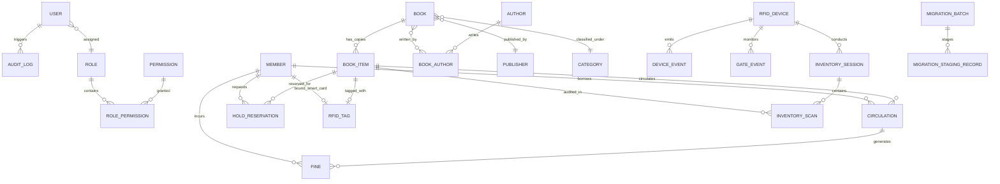

# SmartLib — Database Architecture & Data Dictionary

> **Neon Serverless PostgreSQL Schema Specification**  
> *Production-Grade Relational Data Architecture, Prisma ORM Models & Indexing Strategy*  
> **Version:** 1.0.0-DB | **Target Database:** PostgreSQL 16 (Neon Serverless)

---

## 1. Relational Modeling Principles & Rules

SmartLib enforces strict institutional database modeling principles:

1. **Separation of Bibliographic Record from Physical Copy**:
   - `Book` represents the intellectual work / title (Title, ISBN, Authors, Publisher, Edition, Dewey Decimal / LC Call Number, Abstract).
   - `BookItem` represents the physical circulating asset (Individual Barcode, Accession Number, Condition, Shelf Location, Acquisition Date, Price, Circulation Status).
   - *Rationale*: A university library owns 10 copies of *Clean Code*. Each copy has its own unique accession number, physical wear-and-tear, and RFID tag, but they share a single bibliographic catalog record.
2. **Accession Number Integrity**:
   - Every physical item must possess an immutable, globally unique `accessionNumber` (e.g., `ACC-2026-00124`).
3. **RFID Tag Decoupling & Association**:
   - `RFIDTag` is modeled as a distinct entity storing the hardware EPC (Electronic Product Code), TID (Transponder ID), and UID.
   - An `RFIDTag` is associated 1-to-1 with a `BookItem` or a `Member` smart card. If a physical tag is damaged or replaced, the tag association history is preserved without corrupting the book's circulation history.
4. **Immutable Circulation & Financial History**:
   - `Circulation` records are never deleted upon book return. The status transitions from `ACTIVE` to `RETURNED`, capturing the exact `issuedDate`, `dueDate`, and `returnedDate`.
   - `Fine` records maintain their own ledger linked to the circulation transaction, tracking assessment reasons, amounts, waiver records, and payment receipts.
5. **Session-Based Inventory Reconciliation**:
   - `InventorySession` groups bulk shelf scans.
   - `InventoryScan` records each individual tag detected by handheld readers, recording both the `expectedShelfLocation` (from the database) and `scannedShelfLocation`, enabling immediate automated classification of `VERIFIED`, `MISPLACED`, or `MISSING` items.
6. **Non-Destructive Migration & Auditability**:
   - Staging tables (`MigrationBatch` and `MigrationStagingRecord`) allow uploading and validating ~20,000 legacy records without touching active production tables until reconciled.
   - `AuditLog` captures an append-only timeline of all mutations across all administrative tables.
   - Soft deletes (`deletedAt`) are used on primary entities to prevent foreign key cascading destruction.

---

## 2. Entity-Relationship Diagram (ERD)

---

## 3. Data Dictionary & Table Specifications

### 3.1 Authentication & RBAC

#### `User`
Institutional staff, cataloguers, and administrators.
- `id` (UUID, PK): Unique user identifier.
- `email` (VarChar(255), Unique, Not Null): Staff institutional email address.
- `passwordHash` (VarChar(255), Not Null): Argon2/Bcrypt hashed credential.
- `firstName` (VarChar(100), Not Null): First name.
- `lastName` (VarChar(100), Not Null): Last name.
- `roleId` (UUID, FK -> `Role.id`, Not Null): Assigned security role.
- `status` (Enum: `ACTIVE`, `INACTIVE`, `SUSPENDED`): Account state.
- `lastLoginAt` (Timestamp, Nullable): Last authenticated session timestamp.
- `createdAt` (Timestamp, Default Now): Creation timestamp.
- `updatedAt` (Timestamp, Default Now): Last update timestamp.

#### `Role` & `Permission`
Granular authorization matrix.
- `Role`: `id` (UUID, PK), `name` (VarChar(50), Unique), `description` (VarChar(255)), `isSystemRole` (Boolean).
- `Permission`: `id` (UUID, PK), `code` (VarChar(100), Unique e.g. `circulation:issue`, `catalog:create`, `admin:config`), `description` (VarChar(255)).
- `RolePermission`: Joint table (`roleId`, `permissionId`).

---

### 3.2 Member Management

#### `Member`
Students, faculty, research scholars, and external patrons.
- `id` (UUID, PK): Unique member identifier.
- `cardNumber` (VarChar(50), Unique, Not Null): Institutional ID number / Barcode.
- `smartCardUid` (VarChar(100), Unique, Nullable): ISO 14443A HF RFID card UID for instant tap authentication.
- `firstName` (VarChar(100), Not Null): First name.
- `lastName` (VarChar(100), Not Null): Last name.
- `email` (VarChar(255), Unique, Not Null): Contact email.
- `phoneNumber` (VarChar(30), Nullable): SMS contact number.
- `memberType` (Enum: `STUDENT`, `FACULTY`, `RESEARCH_SCHOLAR`, `STAFF`, `GUEST`): Determines loan allowance policies.
- `department` (VarChar(100), Nullable): Academic department.
- `status` (Enum: `ACTIVE`, `BLOCKED`, `EXPIRED`, `SUSPENDED`): Account status.
- `maxBorrowLimit` (Integer, Default 4): Maximum simultaneous active loans permitted.
- `fineBalance` (Decimal(10,2), Default 0.00): Current accumulated outstanding fines.
- `expiryDate` (Timestamp, Not Null): Membership validity end date.
- `createdAt`, `updatedAt`, `deletedAt`: Standard timestamps.

---

### 3.3 Bibliographic Catalog & Physical Inventory

#### `Book`
Bibliographic master work (Title level).
- `id` (UUID, PK): Unique bibliographic record identifier.
- `title` (VarChar(500), Not Null): Title of the work.
- `subtitle` (VarChar(500), Nullable): Subtitle.
- `isbn13` (VarChar(20), Unique, Nullable): Standard ISBN-13 format.
- `isbn10` (VarChar(15), Nullable): Standard ISBN-10 format.
- `edition` (VarChar(50), Nullable): Edition statement (e.g., "3rd Edition").
- `publisherId` (UUID, FK -> `Publisher.id`, Nullable): Publisher entity link.
- `publicationYear` (Integer, Nullable): Year of publication.
- `categoryId` (UUID, FK -> `Category.id`, Nullable): Primary subject classification.
- `callNumber` (VarChar(100), Nullable): Dewey Decimal (DDC) or Library of Congress (LCC) classification call number.
- `description` (Text, Nullable): Book summary/abstract.
- `coverImageUrl` (VarChar(500), Nullable): Cover thumbnail asset path.
- `language` (VarChar(50), Default "English"): Language code.
- `pageCount` (Integer, Nullable): Extent / page count.
- `createdAt`, `updatedAt`, `deletedAt`: Standard timestamps.

#### `BookItem`
Physical circulating asset / physical copy.
- `id` (UUID, PK): Unique physical copy identifier.
- `bookId` (UUID, FK -> `Book.id`, Not Null): Link to parent title.
- `accessionNumber` (VarChar(50), Unique, Not Null): Physical library accession number (e.g. `ACC-2026-00042`).
- `barcode` (VarChar(50), Unique, Nullable): Physical barcode sticker string.
- `rfidTagId` (UUID, FK -> `RFIDTag.id`, Unique, Nullable): Associated RFID transponder.
- `status` (Enum: `AVAILABLE`, `ISSUED`, `RESERVED`, `LOST`, `DAMAGED`, `IN_TRANSIT`, `REFERENCE_ONLY`, `BINDING`): Current circulation availability.
- `condition` (Enum: `NEW`, `GOOD`, `FAIR`, `WORN`, `DAMAGED`): Physical copy preservation condition.
- `shelfLocation` (VarChar(100), Not Null): Assigned physical location (e.g., `STACK-B/AISLE-04/SHELF-02`).
- `price` (Decimal(10,2), Nullable): Replacement acquisition cost.
- `acquisitionDate` (Timestamp, Default Now): Date acquired by library.
- `isReferenceOnly` (Boolean, Default False): If `true`, system prohibits checkout (non-circulating).
- `createdAt`, `updatedAt`, `deletedAt`: Standard timestamps.

---

### 3.4 RFID Hardware & Telemetry

#### `RFIDTag`
RFID transponder identity and security flags.
- `id` (UUID, PK): Unique internal tag identifier.
- `epc` (VarChar(64), Unique, Not Null): Electronic Product Code (96-bit / 128-bit hex string).
- `tid` (VarChar(64), Nullable): Factory Transponder Identifier (silicon unique serial).
- `tagType` (Enum: `HF_ISO15693`, `HF_ISO14443A`, `UHF_EPC_GEN2`): RFID frequency standard.
- `easArmed` (Boolean, Default True): Anti-theft Electronic Article Surveillance bit (`true` = trigger alarm on exit; `false` = cleared for authorized transit).
- `encodedAt` (Timestamp, Nullable): Timestamp when the physical tag was programmed at the staff station.
- `status` (Enum: `ACTIVE`, `DAMAGED`, `UNASSIGNED`, `DECOMMISSIONED`): Tag operational state.
- `createdAt`, `updatedAt`: Standard timestamps.

#### `RFIDDevice`
Institutional hardware inventory.
- `id` (UUID, PK): Unique device identifier.
- `deviceCode` (VarChar(50), Unique, Not Null): Institutional code (e.g. `STAFF-DESK-01`, `GATE-MAIN-ENTRANCE`).
- `name` (VarChar(100), Not Null): Human-readable name.
- `deviceType` (Enum: `STAFF_STATION`, `HANDHELD_READER`, `SECURITY_GATE`, `SELF_CHECKOUT_KIOSK`, `RETURN_STATION`): Device hardware classification.
- `ipAddress` (VarChar(45), Nullable): Network IP address.
- `macAddress` (VarChar(50), Nullable): MAC address.
- `location` (VarChar(100), Not Null): Physical library location.
- `status` (Enum: `ONLINE`, `OFFLINE`, `MAINTENANCE`, `ERROR`): Real-time connectivity state.
- `lastHeartbeatAt` (Timestamp, Nullable): Last ping received by middleware.
- `firmwareVersion` (VarChar(50), Nullable): Hardware firmware version.
- `createdAt`, `updatedAt`: Standard timestamps.

#### `GateEvent`
Real-time security gate transit and anti-theft log.
- `id` (UUID, PK): Unique gate event identifier.
- `deviceId` (UUID, FK -> `RFIDDevice.id`, Not Null): Gate portal identifier.
- `timestamp` (Timestamp(3), Default Now, Not Null): High-precision event timestamp.
- `tagEpc` (VarChar(64), Nullable): EPC read during the transit.
- `bookItemId` (UUID, FK -> `BookItem.id`, Nullable): Identified book copy (if cataloged).
- `alarmTriggered` (Boolean, Not Null): `true` if EAS bit was armed (unauthorized transit).
- `alarmResolved` (Boolean, Default False): Operator acknowledgement flag.
- `resolvedByUserId` (UUID, FK -> `User.id`, Nullable): Security officer who cleared the alert.
- `resolutionNotes` (Text, Nullable): Incident outcome notes.
- `footfallCount` (Integer, Nullable): Transit sensor counter reading at event time.
- `cctvTimestampRef` (VarChar(100), Nullable): Synchronization token for security camera DVR system.

---

### 3.5 Circulation & Financial Ledger

#### `Circulation`
Book loan transactions.
- `id` (UUID, PK): Unique transaction identifier.
- `bookItemId` (UUID, FK -> `BookItem.id`, Not Null): Copy borrowed.
- `memberId` (UUID, FK -> `Member.id`, Not Null): Patron borrowing the copy.
- `issuedByUserId` (UUID, FK -> `User.id`, Not Null): Staff member who authorized checkout.
- `issuedDate` (Timestamp, Default Now, Not Null): Loan start date.
- `dueDate` (Timestamp, Not Null): Calculated due date based on member policies.
- `returnedDate` (Timestamp, Nullable): Actual return timestamp.
- `returnedToUserId` (UUID, FK -> `User.id`, Nullable): Staff member receiving return.
- `renewalCount` (Integer, Default 0): Number of times extended.
- `status` (Enum: `ACTIVE`, `RETURNED`, `OVERDUE`, `LOST_CLAIMED`): Transaction status.
- `notes` (Text, Nullable): Circulation notes.
- `createdAt`, `updatedAt`: Standard timestamps.

#### `Fine`
Financial penalties for overdue, damaged, or lost books.
- `id` (UUID, PK): Unique fine ledger identifier.
- `circulationId` (UUID, FK -> `Circulation.id`, Nullable): Associated loan transaction.
- `memberId` (UUID, FK -> `Member.id`, Not Null): Patron charged.
- `amount` (Decimal(10,2), Not Null): Total assessed fine.
- `paidAmount` (Decimal(10,2), Default 0.00): Total collected.
- `balance` (Decimal(10,2), Not Null): Remaining outstanding balance.
- `status` (Enum: `UNPAID`, `PARTIALLY_PAID`, `PAID`, `WAIVED`): Payment state.
- `reason` (Enum: `OVERDUE`, `DAMAGED_BOOK`, `LOST_BOOK`, `PROCESSING_FEE`): Charge categorization.
- `receiptNumber` (VarChar(50), Unique, Nullable): Official university payment receipt voucher.
- `waivedByUserId` (UUID, FK -> `User.id`, Nullable): Chief librarian approving waiver.
- `waivedReason` (Text, Nullable): Institutional justification for waiver.
- `createdAt`, `updatedAt`: Standard timestamps.

---

### 3.6 Shelf Inventory & Auditing

#### `InventorySession`
Institutional shelf reading campaign.
- `id` (UUID, PK): Unique session identifier.
- `sessionCode` (VarChar(50), Unique, Not Null): Audit code (e.g., `INV-2026-Q1-SCIENCE`).
- `conductedByUserId` (UUID, FK -> `User.id`, Not Null): Auditor initiating session.
- `deviceId` (UUID, FK -> `RFIDDevice.id`, Nullable): Handheld wand used.
- `targetLocation` (VarChar(100), Not Null): Target room/aisle/shelf scope.
- `startedAt` (Timestamp, Default Now): Session start time.
- `completedAt` (Timestamp, Nullable): Session end time.
- `totalScanned` (Integer, Default 0): Total unique tags read.
- `totalVerified` (Integer, Default 0): Correctly shelved copies.
- `totalMisplaced` (Integer, Default 0): Copies found in wrong shelf locations.
- `totalMissing` (Integer, Default 0): Expected copies not found.
- `status` (Enum: `IN_PROGRESS`, `COMPLETED`, `CANCELLED`): Audit status.

#### `InventoryScan`
Granular item audit detection.
- `id` (UUID, PK): Unique scan record identifier.
- `sessionId` (UUID, FK -> `InventorySession.id`, Not Null): Parent audit session.
- `bookItemId` (UUID, FK -> `BookItem.id`, Nullable): Identified book copy.
- `scannedEpc` (VarChar(64), Not Null): Raw EPC captured by antenna wand.
- `expectedShelfLocation` (VarChar(100), Nullable): Catalogued location.
- `scannedShelfLocation` (VarChar(100), Not Null): Actual location where antenna was sweeping.
- `scanStatus` (Enum: `VERIFIED`, `MISPLACED`, `MISSING`, `UNCATALOGED`): Audit result.
- `scannedAt` (Timestamp, Default Now): Exact scan time.

---

### 3.7 Data Migration Staging & System Control

#### `MigrationBatch`
Orchestrator for legacy library data onboarding (~20k records).
- `id` (UUID, PK): Unique migration batch identifier.
- `batchName` (VarChar(100), Not Null): Batch descriptor (e.g. `LEGACY_KOHA_EXPORT_2026`).
- `sourceFileName` (VarChar(255), Not Null): Original uploaded file name.
- `totalRecords` (Integer, Default 0): Total rows in spreadsheet.
- `validRecords` (Integer, Default 0): Rows passing schema rules.
- `errorRecords` (Integer, Default 0): Rows with format/validation errors.
- `migratedRecords` (Integer, Default 0): Rows successfully committed to production tables.
- `status` (Enum: `UPLOADED`, `VALIDATING`, `VALIDATED`, `DRY_RUN_COMPLETED`, `COMMITTED`, `ROLLED_BACK`, `FAILED`): Pipeline stage.
- `executedByUserId` (UUID, FK -> `User.id`, Not Null): Operator running migration.
- `dryRunSummary` (JsonB, Nullable): Simulated insert/update metrics.
- `createdAt`, `updatedAt`: Standard timestamps.

#### `MigrationStagingRecord`
Row-level staging record.
- `id` (UUID, PK): Unique staging row identifier.
- `batchId` (UUID, FK -> `MigrationBatch.id`, Not Null): Parent batch.
- `rowNumber` (Integer, Not Null): Spreadsheet row number.
- `rawPayload` (JsonB, Not Null): Raw extracted columns as JSON.
- `normalizedPayload` (JsonB, Nullable): Validated and mapped entity structure.
- `validationErrors` (JsonB, Nullable): Array of rule failure descriptions.
- `status` (Enum: `PENDING`, `VALID`, `INVALID`, `COMMITTED`): Row status.

#### `AuditLog`
Immutable compliance and non-repudiation ledger.
- `id` (UUID, PK): Unique log identifier.
- `actorUserId` (UUID, FK -> `User.id`, Nullable): User performing mutation.
- `actorEmail` (VarChar(255), Nullable): Cached email for preservation across user deletion.
- `action` (Enum: `CREATE`, `UPDATE`, `DELETE`, `LOGIN`, `LOGOUT`, `DISARM_EAS`, `ARM_EAS`, `WAIVE_FINE`, `MIGRATION_EXECUTE`, `MIGRATION_ROLLBACK`): Operation performed.
- `entityName` (VarChar(100), Not Null): Target table (e.g., `BookItem`, `Circulation`, `Fine`).
- `entityId` (VarChar(100), Nullable): Target record primary key.
- `previousState` (JsonB, Nullable): Snapshot prior to modification.
- `newState` (JsonB, Nullable): Snapshot following modification.
- `ipAddress` (VarChar(45), Nullable): Client IP address.
- `userAgent` (VarChar(500), Nullable): Client browser user-agent.
- `timestamp` (Timestamp, Default Now, Not Null): Immutable timestamp.

#### `SystemConfiguration`
Institutional parameter registry.
- `id` (UUID, PK): Unique parameter identifier.
- `configKey` (VarChar(100), Unique, Not Null): Configuration key (e.g. `CIRCULATION_STUDENT_MAX_DAYS`, `CIRCULATION_FINE_RATE_PER_DAY`, `GATE_ALARM_DEBOUNCE_MS`).
- `configValue` (Text, Not Null): Serialized parameter value.
- `dataType` (Enum: `STRING`, `INTEGER`, `DECIMAL`, `BOOLEAN`, `JSON`): Type validation hint.
- `category` (VarChar(50), Not Null): Functional group (`CIRCULATION`, `FINES`, `RFID`, `NOTIFICATIONS`, `SECURITY`).
- `description` (VarChar(255), Nullable): Description of the institutional policy.
- `updatedByUserId` (UUID, FK -> `User.id`, Nullable): Last modifier.
- `updatedAt` (Timestamp, Default Now): Last update timestamp.

---

## 4. Indexing & Query Optimization Strategy

To ensure sub-10ms response times on Neon PostgreSQL under multi-user load:

| Table | Index Columns | Index Type | Optimization Target |
| :--- | :--- | :--- | :--- |
| `Book` | `isbn13`, `isbn10` | B-Tree (Unique) | Instant catalog ISBN lookup |
| `Book` | `title` | B-Tree / GIN Trigram | Quick search autocomplete in OPAC |
| `BookItem` | `accessionNumber` | B-Tree (Unique) | Primary barcode/accession scanning |
| `BookItem` | `rfidTagId` | B-Tree (Unique) | Instant RFID-to-physical copy resolution |
| `BookItem` | `status`, `shelfLocation` | Composite B-Tree | Shelf inventory and availability filtering |
| `RFIDTag` | `epc` | B-Tree (Unique) | Sub-millisecond gate antenna lookup |
| `Circulation` | `bookItemId`, `status` | Composite B-Tree | Rapid check if book copy is currently on loan |
| `Circulation` | `memberId`, `status` | Composite B-Tree | Check patron's active borrow count |
| `Circulation` | `dueDate`, `status` | Composite B-Tree | Daily automated overdue calculation worker |
| `GateEvent` | `timestamp` (DESC) | B-Tree | Live security portal feed streaming |
| `GateEvent` | `alarmTriggered` | Partial B-Tree | High-speed filtering of unresolved alarms |
| `AuditLog` | `timestamp` (DESC), `entityName` | Composite B-Tree | Compliance and investigation query filtering |

