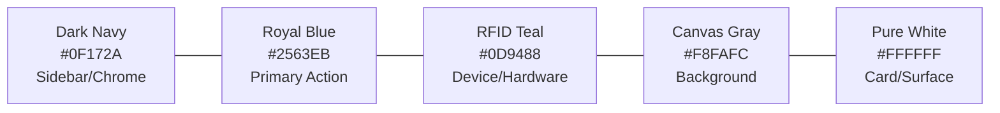

# SmartLib — Design System Specification

> **Institutional Enterprise SaaS Design System**  
> *Formulated using UI/UX Pro Max (Swiss Minimalism) & shadcn/ui Standards*  
> **Version:** 1.0.0-DS | **Primary Theme:** Institutional Academic

---

## 1. Visual Philosophy & Design Direction

SmartLib is tailored for high-density academic and institutional library operations. It eliminates gratuitous decorative elements (oversized rounded corners, heavy drop shadows, neon gradients, glassmorphism, or non-functional animations) in favor of **Swiss Style Functional Minimalism**:

- **Information Density with Breathing Room**: High-throughput tabular data, clear hierarchical forms, and prominent status indicators.
- **Instant Visual Recognition**: High-contrast state indicators for RFID device connectivity, circulation restrictions, and security alarms.
- **Cognitive Clarity**: White and light-neutral primary content canvases anchored by an institutional dark-navy navigation spine.
- **Zero Ambiguity**: Strictly standardized badge colors and icons across all 16 modules.

---

## 2. Color System & Design Tokens

The color architecture is divided into Primitive Tokens, Semantic Tokens, and CSS Custom Properties mapped to Tailwind CSS.

### 2.1 Core Palette Tokens



| Token Name | Hex Code | Role & Usage | Contrast Ratio (vs Background) |
| :--- | :--- | :--- | :--- |
| `primary` | `#2563EB` | Primary buttons, active tabs, selected states, key interactive links | 5.8:1 (AA Passed) |
| `primary-hover` | `#1D4ED8` | Hover/focus states for primary interactive elements | 7.3:1 (AAA Passed) |
| `sidebar-bg` | `#0F172A` | Left-hand navigation rail background | High contrast dark chrome |
| `sidebar-fg` | `#F8FAFC` | Navigation menu item text (inactive: `#94A3B8`) | 12.2:1 (AAA Passed) |
| `background` | `#F8FAFC` | Page canvas background | Baseline |
| `surface` / `card` | `#FFFFFF` | Content containers, data tables, modal dialogs, forms | 1.05:1 (Subtle card border `#E2E8F0`) |
| `text-primary` | `#111827` | Headings, table cells, primary body copy | 15.6:1 (AAA Passed) |
| `text-secondary` | `#64748B` | Metadata labels, helper text, breadcrumbs, table headers | 4.6:1 (AA Passed) |
| `rfid-accent` | `#0D9488` | RFID tag status, active reader beacon, gate status, antenna telemetry | 4.8:1 (AA Passed) |
| `rfid-bg-muted` | `#F0FDFA` | Light teal container background for RFID event cards | Subtle status container |
| `success` | `#16A34A` | Issued books returned, normal gate clearance, verified shelf items | 4.6:1 (AA Passed) |
| `warning` | `#D97706` | Approaching due dates, low fine balances, misplaced shelf books | 4.7:1 (AA Passed) |
| `danger` / `destructive` | `#DC2626` | Overdue loans, gate alarm triggers, blocked members, deletion | 4.6:1 (AA Passed) |
| `border` | `#E2E8F0` | Card borders, table dividers, input borders | Standard structural divider |

### 2.2 Tailwind CSS Variables Mapping (`index.css`)

```css
@tailwind base;
@tailwind components;
@tailwind utilities;

@layer base {
  :root {
    --background: 210 40% 98%;         /* #F8FAFC */
    --foreground: 222 47% 11%;         /* #111827 */
    --card: 0 0% 100%;                 /* #FFFFFF */
    --card-foreground: 222 47% 11%;
    --popover: 0 0% 100%;
    --popover-foreground: 222 47% 11%;
    --primary: 221 83% 53%;            /* #2563EB */
    --primary-foreground: 210 40% 98%;
    --secondary: 210 40% 96%;          /* #F1F5F9 */
    --secondary-foreground: 222 47% 11%;
    --muted: 210 40% 96%;
    --muted-foreground: 215 16% 47%;   /* #64748B */
    --accent: 210 40% 96%;
    --accent-foreground: 222 47% 11%;
    --destructive: 0 84% 60%;          /* #DC2626 */
    --destructive-foreground: 210 40% 98%;
    --border: 214 32% 91%;             /* #E2E8F0 */
    --input: 214 32% 91%;
    --ring: 221 83% 53%;
    --radius: 0.375rem;                /* 6px crisp corners */

    /* Custom SmartLib Institutional Tokens */
    --sidebar-bg: 222 47% 11%;         /* #0F172A */
    --sidebar-fg: 210 40% 98%;
    --sidebar-muted: 215 20% 65%;      /* #94A3B8 */
    --sidebar-hover: 217 33% 17%;      /* #1E293B */
    --rfid-accent: 174 84% 32%;        /* #0D9488 */
    --rfid-muted: 166 76% 97%;         /* #F0FDFA */
  }
}
```

---

## 3. Typography & Numerical Formatting

- **Primary Interface Font**: `Inter, -apple-system, BlinkMacSystemFont, "Segoe UI", Roboto, sans-serif`
- **Numerical / Identifiers Font**: `Inter` with OpenType `tabular-nums` (`font-variant-numeric: tabular-nums`) or `ui-monospace` for:
  - Accession numbers (e.g., `ACC-2026-08942`)
  - RFID EPC / TID Hex Strings (e.g., `E280 1160 2000 7843 9A12 00F1`)
  - Smart card UIDs (e.g., `CARD-STD-44091`)
  - Currency and fine ledgers (e.g., `$14.50`)

### Type Scale

| Style / Level | Size | Weight | Line Height | Usage |
| :--- | :--- | :--- | :--- | :--- |
| **Page Title (H1)** | 1.5rem (24px) | SemiBold (600) | 2rem (32px) | Top-level module headers |
| **Section Title (H2)**| 1.125rem (18px) | SemiBold (600) | 1.75rem (28px) | Card headers, table section titles |
| **Subtitle / Label** | 0.875rem (14px) | Medium (500) | 1.25rem (20px) | Form labels, card metric subtitles |
| **Body Text** | 0.875rem (14px) | Regular (400) | 1.25rem (20px) | Standard cell contents, descriptions |
| **Caption / Meta** | 0.75rem (12px) | Regular (400) | 1rem (16px) | Timestamps, help text, audit hashes |
| **Monospace / Code** | 0.8125rem (13px)| Medium (500) | 1.25rem (20px) | RFID Hex tags, barcode strings |

---

## 4. Layout Architecture & Chrome

```
+---------------------------------------------------------------------------------------+
|  SMARTLIB BRAND  | Top Bar: Global Search | Active Station | Gate Alerts | Profile    |
+------------------+--------------------------------------------------------------------+
| [DASHBOARD]      | Breadcrumb: Circulation > Multi-Item Issue Desk                    |
| [CATALOG]        |--------------------------------------------------------------------|
|   - Books        | [ KPI Card 1 ] [ KPI Card 2 ] [ KPI Card 3 ] [ RFID Station Pill ]  |
|   - Cataloguing  |--------------------------------------------------------------------|
| [MEMBERS]        | Content Surface:                                                   |
| [CIRCULATION]    | +----------------------------------------------------------------+ |
| [RFID SUITE]     | |  Data Table / Interactive Hardware Reader Workspace           | |
|   - Tagging      | |  - High-density columns                                        | |
|   - Devices      | |  - Real-time RFID batch ingestion grid                         | |
|   - Gates        | |  - Accession status badges                                     | |
| [INVENTORY]      | +----------------------------------------------------------------+ |
| [MIGRATION]      |                                                                    |
| [SETTINGS]       |                                                                    |
+---------------------------------------------------------------------------------------+
```

1. **Dark Navy Navigation Sidebar**:
   - Fixed width: `260px` (collapsible to `72px` icon-only mode for compact screens).
   - Deep slate navy (`#0F172A`) backdrop.
   - Distinct section divider labels (`COLLECTION`, `SERVICES`, `HARDWARE`, `ADMIN`).
   - Active item highlighted in Royal Blue (`#2563EB`) with crisp white label and subtle pill radius.
2. **Global Header (Top Bar)**:
   - Height: `64px` with bottom border `#E2E8F0`.
   - Global Instant Search (`Cmd/Ctrl + K`) for instant lookup of books, accession numbers, member IDs, or RFID UIDs.
   - **Hardware Telemetry Widget**: Live pill indicating the connected Staff Station reader status (Online / Ready / Reading) and Security Gate status (Armed / Active).
3. **Workspace Canvas**:
   - Background `#F8FAFC`.
   - Max width container: full viewport with responsive padding (`px-6 py-6`).
   - Cards and data surfaces utilize white background (`#FFFFFF`) with 1px solid border (`#E2E8F0`).

---

## 5. Component Design Standards (shadcn/ui Composition)

### 5.1 Buttons & Interactive Controls
- `Primary`: Royal blue background (`bg-primary text-primary-foreground hover:bg-blue-700`). Used exclusively for the single primary forward action per view (e.g., "Complete Issue", "Encode Tag", "Execute Migration").
- `Secondary`: Light gray (`bg-secondary text-secondary-foreground hover:bg-slate-200`). For secondary actions.
- `Outline`: Bordered neutral (`border border-border bg-white hover:bg-slate-50`). For filters, pagination, cancel actions.
- `Destructive`: Solid red (`bg-destructive text-white hover:bg-red-700`). For member suspensions, record purges, hold cancellations.
- `RFID Action`: Solid teal (`bg-teal-600 text-white hover:bg-teal-700`). For hardware trigger buttons (e.g., "Scan Shelf", "Trigger Reader", "Arm Gate").

### 5.2 Status Badges & Pills
Badges use high-contrast combinations with subtle 10% opacity backdrops:
- **RFID Tagged**: `bg-teal-50 text-teal-700 border-teal-200`
- **Available**: `bg-green-50 text-green-700 border-green-200`
- **Issued / On Loan**: `bg-blue-50 text-blue-700 border-blue-200`
- **Overdue**: `bg-red-50 text-red-700 border-red-200 font-semibold`
- **Misplaced (Shelf Audit)**: `bg-amber-50 text-amber-700 border-amber-200`
- **Reference Only**: `bg-slate-100 text-slate-700 border-slate-300 font-medium`
- **Hardware Online**: Green pulsing dot + `text-slate-800`
- **Hardware Offline**: Amber warning icon + `text-amber-800`

### 5.3 High-Density Data Tables
Library staff process thousands of items daily. Tables must follow strict UX parameters:
- Header row with subtle uppercase typography (`text-xs font-semibold text-slate-500 tracking-wider`).
- Row height: `44px` compact standard with hover background `hover:bg-slate-50/80`.
- Sticky table headers during vertical scrolling.
- Checkbox multi-select column for batch circulation and bulk RFID encoding.
- Action column with contextual dropdown menu (`Lucide: MoreHorizontal`).

### 5.4 Metric KPI Cards
- Standard 4-column responsive grid (`grid grid-cols-1 md:grid-cols-2 lg:grid-cols-4 gap-5`).
- White surface, 1px border, 0.375rem radius.
- Structure: Metric label (text-slate-500 text-xs font-medium), large value (text-slate-900 text-2xl font-bold tabular-nums), subtle secondary delta/trend indicator.

---

## 6. Accessibility (a11y) & Usability Standards

1. **Color Independence**: Status information is never conveyed by color alone. Every badge pairs a color with a distinct text label or semantic icon (e.g., CheckCircle, AlertTriangle, XCircle).
2. **Keyboard Traversal**:
   - Focus indicator: `focus-visible:outline-none focus-visible:ring-2 focus-visible:ring-primary focus-visible:ring-offset-2`.
   - Full keyboard accessibility for modal dialogs, command palettes, and data table pagination.
3. **Contrast Compliance**:
   - Regular text satisfies WCAG 2.1 AA minimum 4.5:1 against light canvas.
   - Large headers satisfy 3:1 minimum.
4. **Hardware Telemetry Announcers**:
   - Real-time security gate transit events and RFID scan batches use ARIA live regions (`aria-live="polite"` or `aria-live="assertive"` for gate alarms) so screen readers notify operators without page refreshes.

