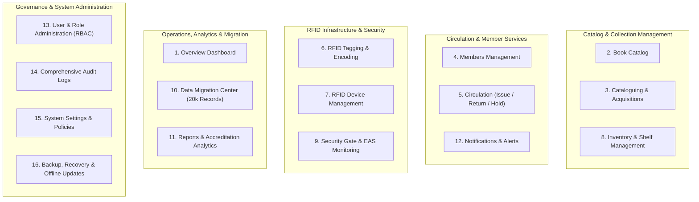
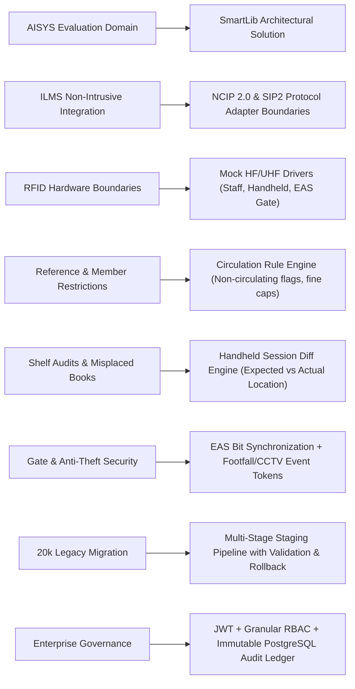

# SmartLib — Product Overview & System Foundation

> **RFID-Enabled Integrated Library Management System**  
> *Engineered to Institutional Standards & AISYS Technical Evaluation Specifications*  
> **Version:** 1.0.0-PROD-SPEC | **Author:** Senior Product Architecture & Engineering Team

---

## 1. Executive Summary

**SmartLib** is an enterprise-grade, RFID-enabled Integrated Library Management System (ILMS) designed for academic institutions, research centers, and university libraries. Traditional library software operates on static manual barcodes and disconnected circulation desks. SmartLib modernizes institutional library workflows by unifying high-frequency/ultra-high-frequency (HF/UHF) RFID hardware integration, real-time security gate transit monitoring, automated self-service circulation boundaries, precision shelf inventory, and robust legacy data migration into a cohesive, secure, and auditable platform.

SmartLib is engineered not as a toy CRUD application, but as a modular, distributed enterprise platform with clean domain boundaries, complete auditability, and strict adherence to institutional data governance standards.

---

## 2. Institutional Problem Statement & Objectives

Institutional libraries encounter acute operational bottlenecks:
1. **Circulation Throughput**: Manual barcode scanning during peak academic hours causes long queues and human data-entry errors.
2. **Book Misplacement & Inventory Inaccuracy**: Physical book audits take weeks or months; misplaced books become effectively "lost" to students and faculty despite appearing as available in OPAC.
3. **Loss Prevention & Unauthorized Removals**: Traditional security systems trigger false alarms or fail to correlate footfall with actual un-issued inventory.
4. **Integration Fragility**: University libraries already operate institutional ILMS (e.g., Koha, Evergreen, proprietary legacy platforms) and cannot afford disruptive, all-or-nothing migrations or vendor lock-in.
5. **Legacy Data Heterogeneity**: Historical library data spread across spreadsheets (>20,000 messy rows) requires multi-stage validation, duplicate detection, dry-run simulation, and rollback protection.

### SmartLib Core Objectives
- **Zero-Loss Item Tracking**: Map every physical book copy (`BookItem`) to an individual RFID Tag (EPC/TID and UID) linked back to a normalized bibliographic master record.
- **Sub-Second Multi-Item Processing**: Enable staff station and self-service readers to read, validate, and issue/return stacks of up to 5 items simultaneously.
- **Automated Anti-Theft Protection**: Maintain EAS (Electronic Article Surveillance) bit state synchronization directly with the circulation transaction lifecycle.
- **Continuous Shelf Audit**: Deploy mobile handheld scanner telemetry to rapidly identify misplaced items, discrepancies, and missing catalog assets.
- **Enterprise Governance**: Enforce strict Role-Based Access Control (RBAC), immutable audit logging for all administrative events, and institutional security standards.

---

## 3. Operational Personas & Roles

SmartLib defines granular institutional personas with targeted permissions and tailored workflows:

| Persona / Role | Operational Scope | Key System Workflows |
| :--- | :--- | :--- |
| **Chief Librarian / Director** | Institutional oversight, system policies, high-level reporting, and collection metrics. | Policy overrides, fine waiver approvals, inventory audit reviews, accreditation report exports. |
| **Cataloguer / Acquisition Officer** | Bibliographic control, authority data, classification (DDC/LCC), copy acquisition. | ISBN lookup, MARC/JSON import, physical copy generation, accession numbering. |
| **Circulation Desk Staff** | Daily front-desk loan processing, member registration, fine collection. | Multi-item checkout/check-in, student ID verification, hold reservations, fine receipt generation. |
| **RFID Tagging & Inventory Auditor** | Physical processing, RFID tag association, shelf-reading, audits. | Blank tag encoding, accession-to-tag binding, handheld shelf audit, misplaced book detection. |
| **Security & Gate Operator** | Physical portal monitoring, alert dispatch, footfall tracking. | Gate alarm resolution, transit log verification, CCTV event correlation, offline incident logging. |
| **System Administrator** | Platform infrastructure, RBAC, hardware connections, backups, migration. | User onboarding, RFID device registry, migration batch execution, system configuration. |
| **Faculty / Student Member** | Self-service research, account inspection, loan renewals, holds. | OPAC catalog discovery, loan status tracking, fine history inspection, digital holds. |

---

## 4. Application Information Architecture & Modules

SmartLib organizes its operational surface into 16 coherent functional modules grouped into 5 enterprise suites:

### Detailed Module Breakdown:
1. **Overview Dashboard**: High-level institutional KPIs (total titles, physical copies, registered members, RFID-tagged items, active loans, overdues, pending fines, active devices), weekly circulation trends, category breakdown, real-time gate transit alerts, and quick action launchpads.
2. **Book Catalog**: Comprehensive searchable, filterable OPAC/Staff catalog with facet filters (category, author, publication year, shelf location, availability status, RFID tag association).
3. **Cataloguing**: Bibliographic entry creation, MARC21/JSON structured ingestion, physical copy batch generation with automated sequential accession numbering.
4. **Members Management**: Student, faculty, and guest registries; smart-card UID binding; active loan counters; eligibility rule verification; fine balance ledgers; account suspension controls.
5. **Circulation**: High-speed issue, return, renewal, and hold reservations. Real-time validation of reference-only restrictions, overdue blocking rules, fine thresholds, and automatic EAS bit flipping.
6. **RFID Tagging**: Station workflow for encoding blank EPC/TID tags, verifying CRC/integrity, and permanently associating tag identifiers with copy accession numbers.
7. **RFID Device Management**: Live registry of all institutional RFID hardware (Staff Stations, Handheld Inventory Scanners, Security Portals, Self-Check Kiosks), tracking IP addresses, firmware versions, heartbeat status, and telemetry.
8. **Inventory & Shelf Management**: Session-based shelf auditing. Compares handheld RFID scan dumps against expected shelf-classification locations; flags missing, present, and misplaced items with precision floor/row/shelf coordinates.
9. **Security Gate Monitoring**: Real-time event stream from security portal antennas. Flags unauthorized item pass-throughs, activates audible/visual alarm status, links timestamped footfall counts, and provides CCTV event reference tokens.
10. **Data Migration Center**: Industrial migration engine for onboarding ~20,000 legacy records. Features raw staging tables, rule-based data validation, duplicate detection, dry-run simulation mode, migration reconciliation metrics, and one-click rollback capabilities.
11. **Reports & Analytics**: Institutional intelligence: circulation frequency, popular titles, collection turnover rate, loss rates, shelf utilization, peak usage hours, and exportable accreditation compliance reports.
12. **Notifications**: Multi-channel alert dispatch (Email, SMS, system banners, print receipts) for due date reminders, overdue warnings, fine notices, and hold availability notifications.
13. **User & Role Administration**: Enterprise RBAC interface for creating operators, assigning granular permission scopes (e.g., `circulation:issue`, `catalog:create`, `admin:config`), and password management.
14. **Audit Logs**: Immutable system ledger recording actor identity, timestamp, IP address, user-agent, target entity, operation type, and before/after state diffs for all mutation actions.
15. **System Settings**: Global institutional parameter configuration: loan durations by member category, fine accumulation rates, grace periods, maximum renewal counts, lost book replacement multipliers, and adapter endpoints.
16. **Backup & Offline Updates**: Database backup orchestrator, snapshot management, offline deployment bundle validation, and offline security-gate log replay synchronizers.

---

## 5. AISYS Technical Evaluation Alignment

SmartLib is built directly against the evaluation standards specified by AISYS:

---

## 6. Target Production Topology

- **Web Client**: React 18+ Single Page Application with client-side routing, optimistic UI updates, and responsive dashboard layouts.
- **API Server**: Node.js & Express application running in TypeScript with clean controller-service-repository layering and Zod contract validation.
- **Persistence**: **Neon Serverless PostgreSQL** utilizing connection pooling (`DATABASE_URL`) for regular traffic and unpooled direct connection (`DIRECT_URL`) for schema migrations.
- **Hardware Integration Layer**: Python FastAPI RFID middleware acting as a hardware abstraction bridge, communicating with USB/Ethernet/Serial readers and delivering normalized telemetry over WebSockets/REST.

