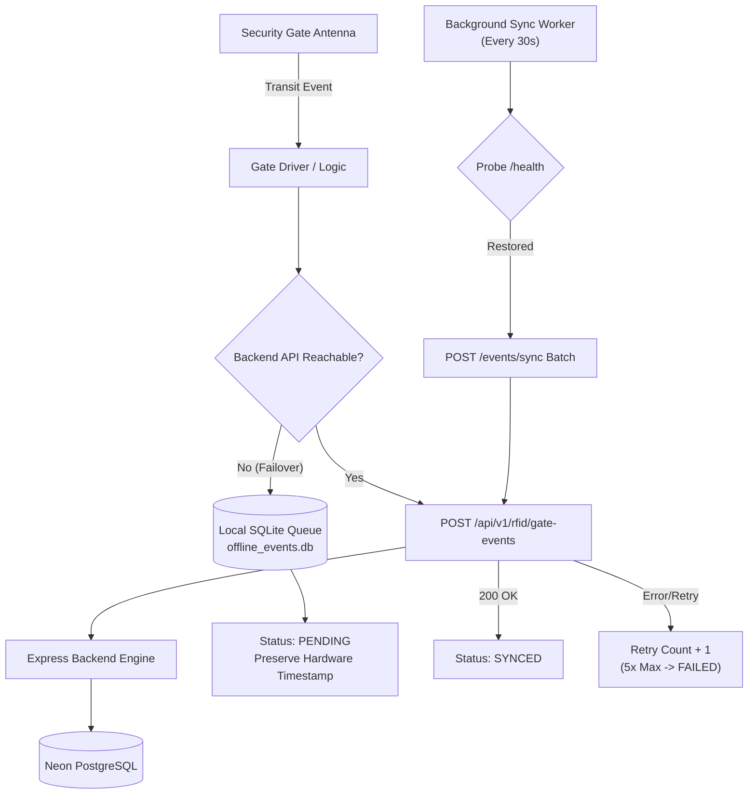

# SmartLib — RFID Edge Middleware Specification

> **IoT Edge Gateway, Hardware Emulation & Anti-Theft Protocol**  
> **Version:** 1.0.0-RFID | **Status:** Active Implementation Blueprint

---

## 1. Architectural Role & Boundary

The **SmartLib RFID Middleware Service** operates as an edge IoT gateway running locally or on edge gateway appliances inside the library facility. It isolates the physical and mock RFID readers from the central Express.js / Neon PostgreSQL cloud backend.

### Core Principles
1. **No Direct Database Access**: The middleware does not connect to Neon PostgreSQL. All item statuses, EAS disarmament rules, and patron verifications are mediated through the Express REST API.
2. **Sub-second Edge Decisions**: The security gate driver can evaluate incoming EPC transits locally or via lightweight edge cache within < 50ms.
3. **Resilient Local Buffer**: In the event of a campus network failure or cloud disconnection, security gate transit telemetry is stored in an encrypted local SQLite database and automatically drained upon reconnection.
4. **Mock Hardware vs Physical Hardware Separation**: When physical hardware is not attached, the service operates in deterministic software emulation mode (`MOCK_HARDWARE=true`), explicitly marking all telemetry with `mock_emulator: true`.

---

## 2. Supported Hardware Adapters & Emulators

### 2.1 Staff Desk Station Reader
- **Protocols Supported**:
  - HF ISO 15693 / ISO 14443A (13.56 MHz)
  - UHF EPC Gen2 / ISO 18000-6C (865–868 MHz)
- **Physical Capabilities**:
  - Multi-tag reading (1 to 5 books stacked on antenna pad)
  - EPC decoding and accession number association
  - Anti-collision reading
  - EAS bit status reporting (armed / disarmed)
  - Session-level duplicate scan detection (30-second window)

### 2.2 Handheld Inventory Scanner
- **Protocols Supported**:
  - UHF EPC Gen2 (860–960 MHz)
- **Physical Capabilities**:
  - High-speed batch reading (> 50 tags per second)
  - RSSI signal strength tracking (useful for pinpointing misplaced books)
  - Instantaneous shelf reconciliation:
    - **VERIFIED**: Item found on expected catalog shelf coordinate.
    - **MISPLACED**: Item found on wrong shelf (flags immediate reshelving task).
    - **MISSING**: Item expected on shelf but unread after full scan.
    - **UNCATALOGED**: Tag detected with no active catalog record.

### 2.3 Security Gate (Dual-Pedestal EAS)
- **Protocols Supported**:
  - UHF EPC Gen2 Dual-Pedestal Antenna System (20 Hz polling)
- **Physical Capabilities**:
  - Continuous field polling
  - Instantaneous EAS bit verification:
    - `eas_armed == false`: Item checked out through circulation. Authorized transit.
    - `eas_armed == true`: Item un-issued or Reference Only. Alarm triggered.
  - Hardware alarms: Audio siren buzzer and red optical LED strobe.
  - Integrated optical bidirectional footfall beam counter.
  - CCTV camera timestamp token generation for surveillance DVR synchronization.

---

## 3. Offline Buffering & Resiliency Architecture

### Guarantees:
- **Timestamp Integrity**: The original hardware timestamp with millisecond precision is preserved throughout offline buffering and replay.
- **Idempotency & Deduplication**: Every event carries a globally unique `event_id` (UUIDv4). Duplicate events are rejected at both SQLite and backend boundaries.
- **Crash Recovery**: Transactions are committed to SQLite with WAL mode (`PRAGMA journal_mode=WAL`), ensuring no event loss even if the middleware process crashes or power drops.

---

## 4. Production Hardware Integration Boundaries

To connect real physical RFID hardware:

| Device | Real Hardware Driver Class | Connection Protocol |
| :--- | :--- | :--- |
| Staff Station | `drivers.hardware.feig_reader` / `zebra_fx7500` | USB HID / Serial RS232 / TCP |
| Handheld Scanner | `drivers.hardware.chainway_c72` | Bluetooth SPP / TCP WebSocket Stream |
| Security Gate | `drivers.hardware.impinj_speedway` | LLRP (Low Level Reader Protocol) TCP port 5084 |
| Smart Card Tap | `drivers.hardware.acr122u` | PC/SC USB CCID (ISO 14443A) |

Setting `MOCK_HARDWARE=false` in `.env` activates real hardware driver factories while maintaining identical API and data schemas.

