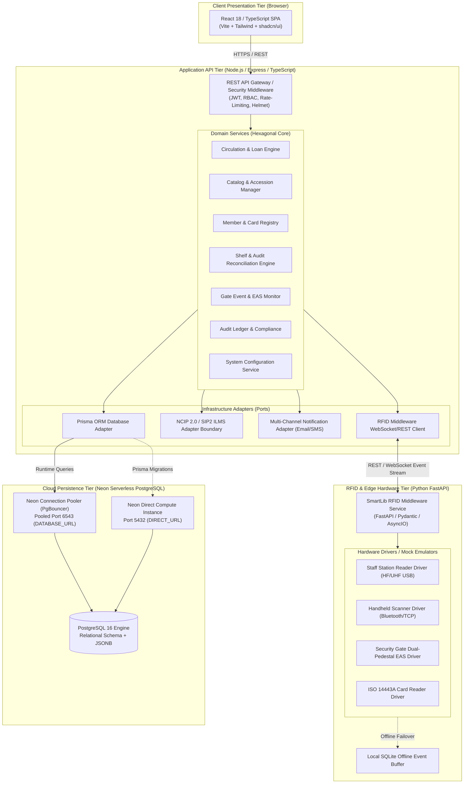

# SmartLib — System Architecture & Technical Specification

> **RFID-Enabled Integrated Library Management System**  
> *Enterprise Hexagonal Architecture, Hardware Adapters & Neon PostgreSQL Topology*  
> **Version:** 1.0.0-ARCH | **Status:** Active Architectural Blueprint

---

## 1. Architectural Style & Core Principles

SmartLib is architected as an **Enterprise Modular Monolith with Clean / Hexagonal (Ports & Adapters) boundaries**. This balances high operational cohesion with strict physical boundaries between the web application, persistence tier, external ILMS protocols, and physical RFID hardware telemetry:



### Core Architecture Tenets:
1. **Decoupled Hardware Abstraction**: No web or Node.js service speaks raw serial or low-level LLRP/TCP protocol to RFID readers. All hardware interaction is mediated by the Python RFID Middleware service.
2. **Deterministic Domain Rules**: The circulation engine strictly enforces non-circulating reference restrictions, member suspension thresholds, and fine caps *before* issuing any command to clear the EAS tag bit.
3. **Audit Immutability**: All administrative modifications, circulation state transitions, tag bindings, and gate triggers are written to an append-only audit log table.
4. **Idempotent Ingestion**: Gate transit events, handheld inventory batch scans, and legacy migration batches are processed idempotently using unique hashes and batch IDs.

---

## 2. Component Layers & Responsibilities

### 2.1 Frontend Client (React + TypeScript + Vite)
- **Role**: Institutional Single-Page Application (SPA) providing sub-second reactivity for circulation staff, cataloguers, and administrators.
- **Key Modules**:
  - `components/ui/*`: Primitive shadcn/ui components customized with SmartLib design tokens.
  - `features/circulation`: High-speed multi-item checkout, check-in, and holds workspace.
  - `features/catalog`: Bibliographic record editor, physical copy manager, barcode/tag generator.
  - `features/rfid`: Live device status dashboard, blank tag encoder, antenna reader monitor.
  - `features/inventory`: Handheld session manager, shelf misplaced book visualizer.
  - `features/gate`: Real-time gate alarm alert monitor with audio-visual indicators.
  - `features/migration`: Multi-stage data onboarding console for legacy library spreadsheets.
- **State Management & Data Fetching**: TanStack Query (React Query) for server state caching, optimistic mutation, and automated cache invalidation.

### 2.2 Backend Application Server (Node.js + Express + TypeScript)
- **Role**: RESTful API implementing institutional business rules, authentication, RBAC authorization, and persistence orchestration.
- **Layering**:
  - `routes/`: Express endpoint declarations with route-level security guards.
  - `controllers/`: HTTP protocol adapters, input sanitization, and response formatting.
  - `middleware/`: JWT verification, RBAC permission evaluation (`hasPermission('circulation:issue')`), Zod schema validation, global error handling.
  - `services/`: Pure business logic containing no HTTP concerns (e.g., `CirculationService.issueBook()`, `InventoryService.reconcileSession()`).
  - `repositories/`: Data access layer utilizing Prisma Client.

### 2.3 RFID Hardware Middleware (Python 3.12 + FastAPI)
- **Role**: Edge hardware gateway interfacing with physical or mock RFID reader hardware.
- **Protocol Support**:
  - **HF (13.56 MHz, ISO 15693 / ISO 14443A)**: Commonly used for item tagging and student smart ID cards.
  - **UHF (860–960 MHz, EPC Gen2 / ISO 18000-6C)**: High-speed range for security gates and inventory shelf wands.
- **Components**:
  - `drivers/staff_station.py`: Reads multiple book tags placed on the desk pad; triggers EPC encoding and EAS bit modification.
  - `drivers/security_gate.py`: Continuous antenna polling; compares passing EPC tags against the active circulation cache. Fires audible alarm and visual red strobe if an un-issued tag transits.
  - `drivers/handheld_scanner.py`: Ingests burst RFID scans during inventory shelf reading; emits batch payloads with RSSI signal strengths.
  - `buffer/offline_sync.py`: Local SQLite store buffering gate events when network connectivity to the central server drops. Replays events with exact hardware timestamps upon reconnection.

### 2.4 Data Migration Engine (Python + Pandas + OpenPyXL)
- **Role**: High-capacity data ingestion pipeline capable of parsing, validating, and staging ~20,000 legacy records without corrupting production data.
- **Pipeline Stages**:
  1. **Upload & Parse**: Ingest `.xlsx`, `.csv`, `.json` legacy catalog files into staging tables.
  2. **Rule Validation**: Validate ISBN-10/13 formats, publication years, call number syntax, accession uniqueness, and foreign key references.
  3. **Duplicate Detection**: Fuzzy title/author matching and exact ISBN/accession deduplication.
  4. **Dry-Run Simulation**: Emulates the entire import transaction, generating an error/warning ledger without writing to production tables.
  5. **Reconciliation & Commit**: Executes transactional batch inserts into `Book`, `BookItem`, `Author`, and `Category` tables.
  6. **Rollback Snapshot**: Maintains the batch ID on all ingested rows, enabling one-click rollback if anomalies are discovered post-migration.

---

## 3. Neon Serverless PostgreSQL Database Strategy

SmartLib is purpose-built to operate seamlessly on **Neon Serverless PostgreSQL**.

### 3.1 Connection Architecture: Pooled vs. Direct
Neon utilizes an autoscaling serverless architecture with a built-in PgBouncer connection pooler:

1. **Pooled Connection (`DATABASE_URL`)**:
   - Host format: `ep-xyz-pooler.us-east-2.aws.neon.tech`
   - Port: `6543` (PgBouncer transaction mode)
   - Usage: All standard backend application queries, Express API requests, and read/write transactions.
   - Purpose: Prevents connection exhaustion when multiple backend nodes or serverless functions scale up.
2. **Direct Connection (`DIRECT_URL`)**:
   - Host format: `ep-xyz.us-east-2.aws.neon.tech`
   - Port: `5432` (Direct PostgreSQL connection)
   - Usage: Prisma CLI migrations (`prisma migrate dev`, `prisma migrate deploy`, `prisma db push`).
   - Purpose: PgBouncer in transaction mode does not support session-level features (e.g., advisory locks, prepared statements) required by Prisma schema migration engines.

### 3.2 Prisma Schema Configuration for Neon

```prisma
datasource db {
  provider  = "postgresql"
  url       = env("DATABASE_URL")
  directUrl = env("DIRECT_URL")
}
```

### 3.3 Autoscaling & Cold-Start Considerations
- **Connection Timeout Handling**: Configured Prisma client with retry logic (`maxWait: 5000, timeout: 10000`) to gracefully handle Neon compute endpoint spin-up from idle state.
- **Connection Pool Sizing**: Configured connection limits in connection strings (`?connection_limit=20&pool_timeout=15`).

---

## 4. Hardware Integration Boundaries & Security Protocol

```
+-------------------------------------------------------------------------------------------------+
|                                     CIRCULATION WORKFLOW                                        |
+-------------------------------------------------------------------------------------------------+
|                                                                                                 |
|   1. Place Books on Pad          2. Scan Student ID            3. Validation & EAS Disarm       |
|   +-----------------------+      +-----------------------+     +-----------------------------+  |
|   | Staff Station Reader  |      | Smart Card Reader     |     | Central API Circulation Svc |  |
|   | Reads 1-5 RFID Tags   | ---> | Reads ISO 14443A UID  | --> | - Verify Loan Allowance     |  |
|   | (EPC Hex + Data)      |      | Card: "STD-2026-99"   |     | - Check Overdues & Fines    |  |
|   +-----------------------+      +-----------------------+     | - Verify Non-Circulating    |  |
|                                                                +-----------------------------+  |
|                                                                               |                 |
|                                                                               v                 |
|   5. Pass Through Gate           4. Success & Physical Action   4. Write Database & Disarm EAS  |
|   +-----------------------+      +-----------------------+     +-----------------------------+  |
|   | Security Gate Antenna | <--- | Issue Receipt Printed | <-- | - Set ItemStatus = ISSUED   |  |
|   | EAS Bit = 0 (CLEAR)   |      | Student Collects Book |     | - EAS Bit Set to 0 (Clear)  |  |
|   | Green Light / Transit |      | Screen Confirms Issue |     | - RFID Reader Writes Tag    |  |
|   +-----------------------+      +-----------------------+     +-----------------------------+  |
|                                                                                                 |
+-------------------------------------------------------------------------------------------------+
```

### 4.1 Security Gate Monitoring & Anti-Theft Protocol
The RFID Security Gate operates continuously at institutional exits:
1. **Detection Loop**: Dual-pedestal antennas poll UHF/HF fields at 20 Hz.
2. **EAS Bit Inspection**:
   - If a tag is read with `EAS Bit = 0` (Disarmed/Cleared): The item has been properly issued. Transit logged as authorized. Green indicator flashes.
   - If a tag is read with `EAS Bit = 1` (Armed/Set): The item is un-issued or flagged as Reference Only.
3. **Alarm Escalation**:
   - High-decibel audio siren and red optical strobe trigger immediately.
   - The gate controller transmits an instantaneous `GateEvent` to the Python middleware.
   - The event records: timestamp (millisecond precision), Tag UID, antenna channel, physical gate location, current footfall sensor count, and a CCTV timestamp token.
   - The central web dashboard receives a high-priority WebSocket alert, highlighting the item title, accession number, and gate location on the security console.

### 4.2 Handheld Inventory Wand Protocol
1. Auditor initiates an **Inventory Session** in the web app, selecting a target room, aisle, and shelf range.
2. The auditor scans shelves using the mobile wand. The wand captures 50+ tags per second.
3. The scan stream is bundled into batches and posted to the `/api/v1/inventory/sessions/:id/scan` endpoint.
4. The **Reconciliation Engine** compares the scanned accession numbers against the expected catalog shelf locations:
   - **Verified**: Item found on its assigned shelf.
   - **Misplaced**: Item catalogued for Shelf A-03 but scanned on Shelf C-12. (Flagged for reshelving).
   - **Missing**: Item catalogued for the scanned shelf but not detected.
   - **Uncataloged**: RFID tag detected that has no active database association.

---

## 5. Security Architecture & Threat Mitigation

| Security Domain | Implementation | Threat Mitigated |
| :--- | :--- | :--- |
| **Authentication** | JSON Web Tokens (RS256/HS256) with 15-minute access token and HTTP-only, secure, SameSite refresh cookies. | Credential theft, session hijacking, replay attacks. |
| **Authorization** | Granular Role-Based Access Control (RBAC) checked on every Express route and UI action. | Privilege escalation, unauthorized catalog mutation. |
| **Password Storage** | Argon2id / Bcrypt with configurable cost factor (minimum 12 rounds). | Offline hash cracking, dictionary attacks. |
| **API Boundary Defense**| Zod runtime schema validation on all request bodies, query params, and URL params. | SQL injection, parameter tampering, payload poisoning. |
| **Transport Security** | Strict HTTPS enforcement, TLS 1.3, HSTS, CSP, and secure CORS whitelist. | Man-in-the-Middle (MitM) eavesdropping, XSS. |
| **Auditability** | Dedicated `AuditLog` table capturing actor, action, IP, entity, and state diffs. | Non-repudiation, insider threat investigation. |
| **Database Isolation** | Prisma parameterized queries + Neon TLS encrypted connections (`sslmode=require`). | SQL injection, database wire sniffing. |

---

## 6. Resilience, Backup & Offline Updates

1. **Gate Telemetry Offline Buffer**: If network communication between the security gates and the central server is interrupted, the Python middleware stores up to 100,000 gate events locally in an encrypted SQLite buffer. When the link is restored, events are drained into Neon PostgreSQL with original hardware timestamps.
2. **Automated Database Backups**: Neon point-in-time recovery (PITR) combined with daily logical database dump orchestrations (`pg_dump` compressed snapshots stored in encrypted object storage).
3. **Offline Deployment & Air-Gapped Environments**: SmartLib provides containerized Docker Compose manifests bundled with local SQLite/PostgreSQL fallbacks and offline asset mirrors for environments with restricted internet access.

